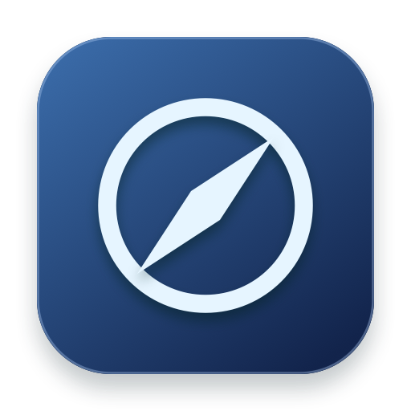

# Navigy



Navigy is a personal macOS menu bar app for acting on selected text. Highlight text to open the floating toolbar, or press **⌥⌘C** to search all actions. The action engine comes from OpenClip. Navigy adds its own interface, including a compact toolbar with a **More** menu. The toolbar suggests actions using the selection and your recent actions in that app. Navigy stores action IDs locally and keeps reading and writing history separate.

- A detected currency, zoned time, measurement, dimension, or hex color appears at the front of the toolbar. The currency defaults to INR and can be changed under **Settings → General → Conversions**. Exchange-rate lookups send currency codes only to Frankfurter. Time and unit conversions run locally.
- Navigy offers Apple Translate for detected non-English text on macOS 15 and later. macOS may ask to download a language pack.
- Copy or transform text, open links, run calculations, and copy or replace inline results.
- Capture text from part of the screen with **Capture Text** in the menu bar.
- Customize the toolbar and shortcuts in **Settings**. OpenClip extensions can be installed from the built-in catalog or imported from a local `.openclipext` package.
- Navigy keeps extensions, rules, and secrets in `~/.navigy` and uses its own macOS preferences domain. Navigy has no app updater. Extension updates are optional in **Settings → Extensions**.

## Build and run

Get the macOS preview from [GitHub Releases](https://github.com/Voryn-Labs/navigy/releases). The preview uses ad-hoc signing and has no Apple notarization. Its release notes list the supported architecture and macOS version.

To rebuild with Xcode 26 or later, open `Navigy.xcodeproj`, select the **Navigy** scheme, and press **Run**. The first build resolves the Swift dependencies. After changing the project specification or adding source files, run `xcodegen generate` to regenerate the project.

On first launch, enable **Navigy** in **System Settings → Privacy & Security → Accessibility**. macOS may ask you to reopen Navigy after granting access. Screenshot OCR also uses Screen Recording permission.

## Local signing

The local preview uses ad-hoc signing. macOS ties an Accessibility grant to the code signature, so an ad-hoc rebuild can require the grant again. For a consistent identity, keep the same bundle ID and app path, and reuse the same Keychain signing identity on each build. The signing script accepts an explicit identity:

```sh
./scripts/sign_artifact.sh build/Navigy.app --identity "Your code-signing identity"
```

After switching from ad-hoc signing to a certificate, grant Accessibility once for the newly signed app.

## Voryn Labs

<a href="https://voryn-labs.github.io/"></a>

[Voryn Labs website](https://voryn-labs.github.io/) · [GitHub organization](https://github.com/Voryn-Labs)

## Upstream

This is a modified build of [OpenClip](https://github.com/ganeshmshetty/openclip), based on commit [88c381a](https://github.com/ganeshmshetty/openclip/commit/88c381a8e74c56804b0f88f3a0667e48c118811b). It retains the original notices and [AGPL-3.0 license](LICENSE).
